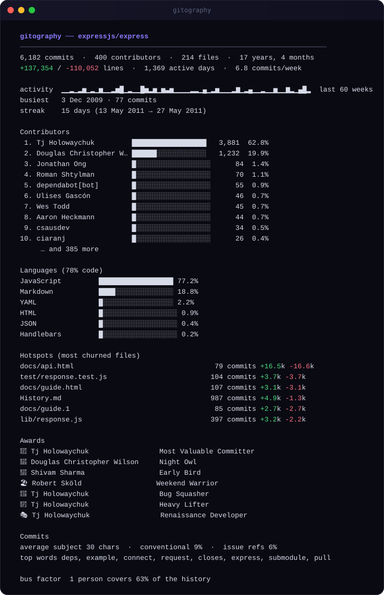
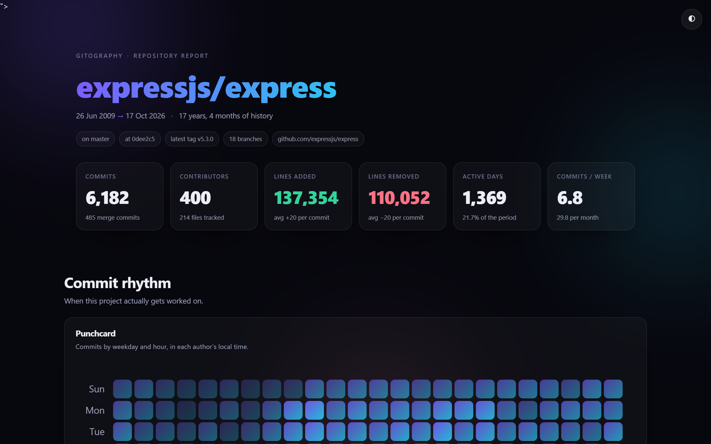
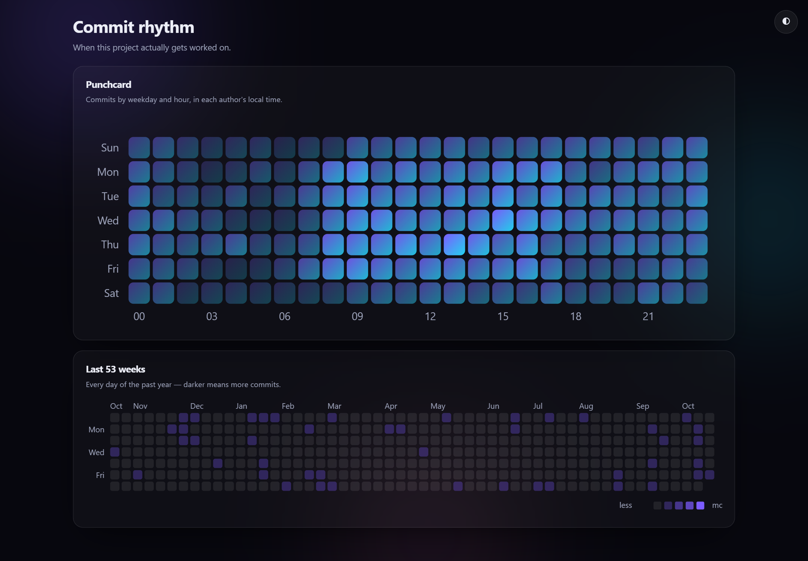
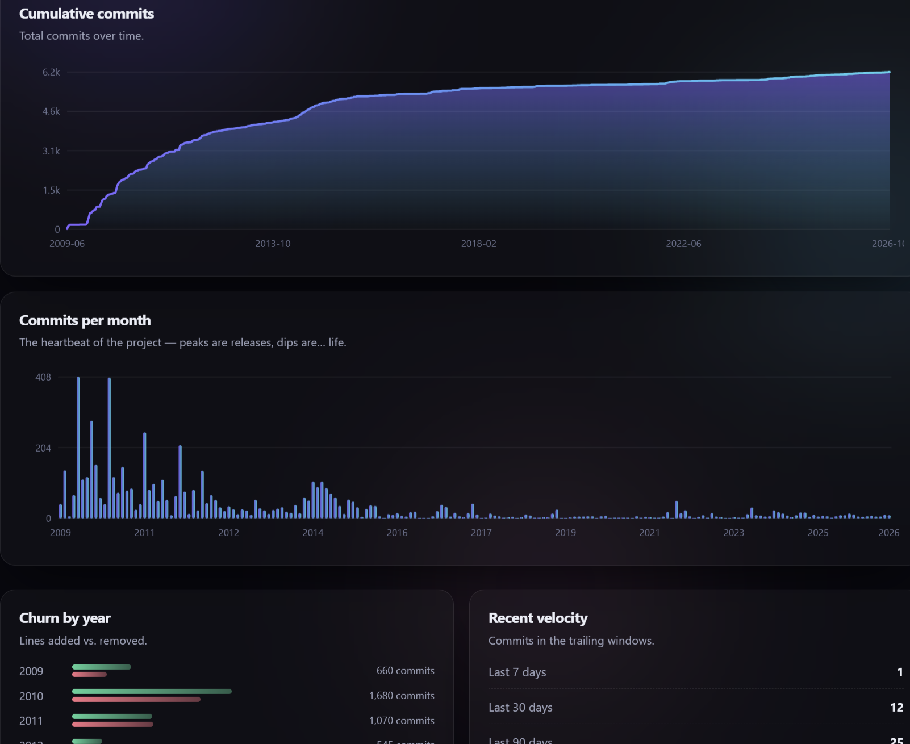
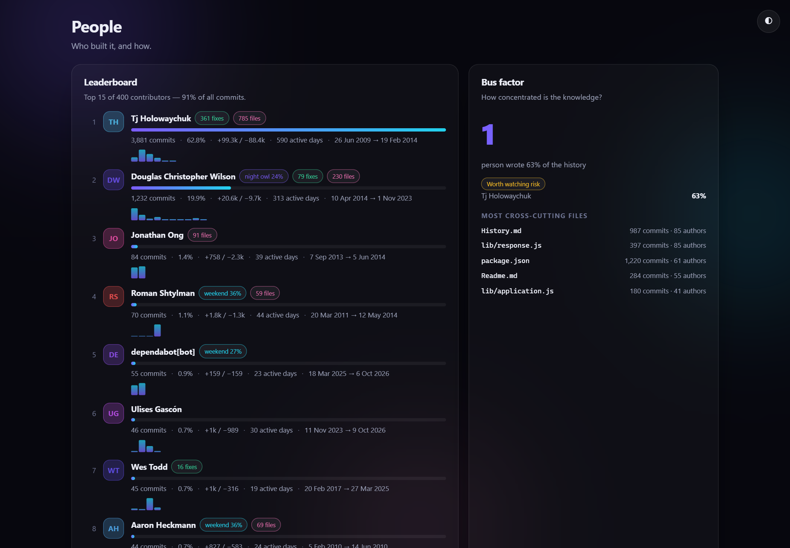
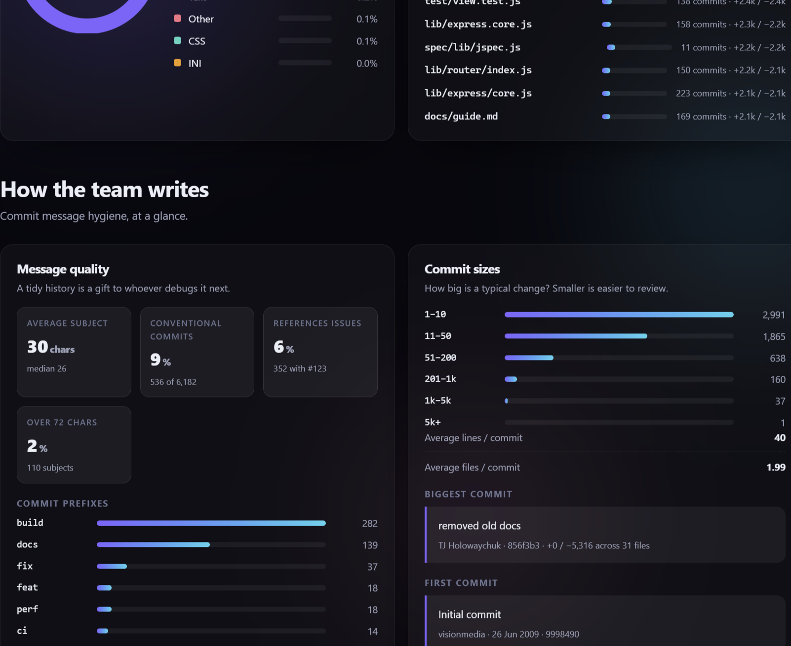
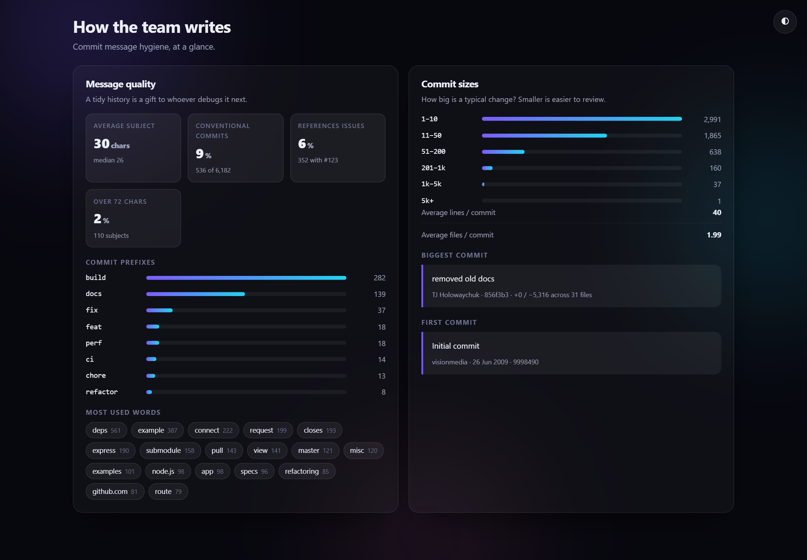
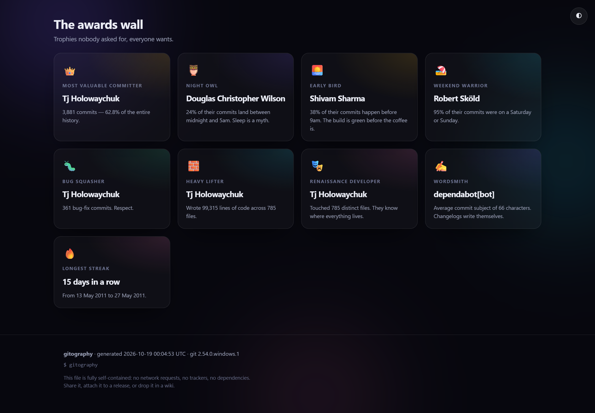

<div align="center">

# gitography

**A year-in-review report for your Git repository.**

Point it at any repository, get back a beautiful, interactive, single-file report
of how that codebase was actually built — who wrote it, when, how the habit
looks, and which files keep changing.

If you have seen the wrapped-style recaps that appear every December, you know
the format: this is that, for a codebase.

**Live demo:** [the report for `expressjs/express` — 6,182 commits, 400 people, 17 years →](https://arifs122.github.io/gitography/demo/express.html)

[](https://www.npmjs.com/package/gitography)
[](https://github.com/arifs122/gitography)
[](https://github.com/arifs122/gitography/actions)
[](https://nodejs.org)
[](LICENSE)
[](CONTRIBUTING.md)



</div>

---

```bash
npx gitography
```

That is the whole workflow. No config file, no account, no build step, no
network access.

## Why

Every repository already contains a story. `git log` shows you one line at a
time; GitHub Insights shows you the same shallow charts for one repository at a
time, and only when you are online and authenticated. Neither gives you a thing
you would actually want to attach to a release, paste into a retro, or send to
the person who joined last week.

gitography reads the history through the `git` you already have and renders one
HTML file that:

- **is completely self-contained** — no CDN, no fonts, no analytics, no
  `<script src>`. Open it on a plane and it looks identical;
- **works on any repository** — public, private, internal, a `--bare` mirror, a
  shallow clone on a build agent;
- **has zero runtime dependencies** — the install is the download, which is why
  `npx` feels instant;
- **reads author-local time**, so the punchcard shows when people in *their*
  timezone actually committed, not a UTC smear.

## Quick start

```bash
# inside a repository
npx gitography

# somewhere else
npx gitography ~/code/my-app

# write a Markdown summary you can paste into a README
gitography . --format md >> README.md

# only the last two years, light theme, opened in the browser
gitography . --since 2024-01-01 --theme light --open
```

Not on npm in your environment yet? Run it straight from a clone — there is
nothing to install:

```bash
git clone https://github.com/arifs122/gitography.git
cd gitography
node bin/gitography.js /path/to/your/repo
```

## What you get

A single `gitography-report.html` (about 120–200 KB for a large history).
Everything below is generated from `expressjs/express` — 6,182 commits by 400
people over 17 years — and the full report is committed at
[`docs/demo/express.html`](docs/demo/express.html).

### The headline



Commits, contributors, line churn, active days and velocity, plus the branch,
the current HEAD, and the latest tag.

### Commit rhythm



A weekday × hour punchcard in each author's local time, a 53-week contribution
calendar, the busiest hour and weekday, and streaks — including the longest
silence the project ever took.

### Momentum



Cumulative commits over the whole lifetime, commits per month, churn by year,
and commits in the trailing 7/30/90/365 days.

### People



A leaderboard with per-person sparklines (one bar per active year), badges for
night-owl and weekend behaviour, and a bus-factor panel: how few people would
have to win the lottery before nobody understands the codebase. Identities are
merged by email, so `Ada L <a@x.com>` and `Ada Lovelace <a@x.com>` are one
person.

### What it is made of



Language composition by tracked bytes at `HEAD` (binary assets, lockfiles and
minified files excluded), the share that is actual code, and the hotspots —
files with the most churn, which is usually where the bugs and the missing tests
live.

### How the team writes



Average and median subject length, Conventional Commits adoption, issue
references, the most-used words, the commit size distribution, plus the biggest
and the very first commit.

### The awards wall



Trophies nobody asked for and everybody wants: Most Valuable Committer, Night
Owl, Early Bird, Weekend Warrior, Bug Squasher, Heavy Lifter, Renaissance
Developer, Wordsmith, Longest Streak. This is the part people screenshot.

## Options

```
Usage
  $ gitography [path] [options]

Arguments
  path                     repository or any path inside one (default: .)

Output
  -f, --format <fmt>       html | json | md | text          (default: html)
  -o, --output <file>      output path
      --open               open the HTML report in your browser
      --theme <name>       dark | light                    (default: dark)
      --title <text>       override the report title
      --subtitle <text>    add a subtitle under the title

Scan
      --limit <n>          maximum commits to scan          (default: 25000)
      --since <date>       only analyse commits after this date
      --until <date>       only analyse commits before this date
      --all                include every branch and ref (default: current HEAD)
      --no-merges          exclude merge commits from the analysis
      --top <n>            contributors to show in the report     (default: 15)
      --hot <n>            hotspot files to show in the report    (default: 20)

Misc
  -q, --quiet              suppress everything except errors
      --no-color           disable ANSI colours
  -h, --help               show this help
  -v, --version            show the version
```

### Output formats

| Format | Writes to | Use it for |
| --- | --- | --- |
| `html` | `gitography-report.html` | the report itself — share it, attach it, commit it |
| `json` | stdout (or `-o`) | your own dashboards, CI metrics, further analysis |
| `md` | stdout (or `-o`) | pasting a summary into a README or a wiki page |
| `text` | stdout (or `-o`) | reading in a terminal, or logging in CI |

Exit codes: `0` success, `1` bad arguments, `2` environmental failure (not a
repository, missing path, git not installed).

Example: a repository-health step in CI.

```yaml
- run: npx gitography . --format json -o gitography.json
- run: npx gitography . --format html -o public/report.html
```

## How it works

```
git log --numstat --pretty=format:…   ──▶  collect()   raw dataset
git ls-tree -r -l HEAD                ──▶
                                            │
                                            ▼
                                        analyze()     pure metrics, no formatting
                                            │
                        ┌───────────────────┼───────────────────┐
                        ▼                   ▼                   ▼
                   renderHtml()       renderMarkdown()      renderText()
```

- **`src/collect.js`** shells out to git. One `git log --numstat` call gathers
  everything about the history; one `git ls-tree` gathers the file list and blob
  sizes. Fields are framed with ASCII unit/record separators so paths containing
  tabs, quotes or unicode cannot corrupt the parse.
- **`src/analyze.js`** is pure. It takes the raw dataset and returns a plain,
  JSON-serialisable report — which is why `--format json` is essentially free.
- **`src/render-*.js`** are pure too: report in, string out. No globals, no I/O,
  no chance of a metric disagreeing between the terminal and the HTML.
- **`src/awards.js`** is the only intentionally opinionated module.

Everything downstream of `collect()` is deterministic, so the whole pipeline is
testable without touching a real repository.

## Design principles

1. **Zero runtime dependencies.** Not "few" — zero. `npx gitography` must never
   wait on a package tree, and the tool must still work in five years.
2. **No network, ever.** gitography does not check for updates and does not talk
   to GitHub. Your history stays on your machine; the report is a local file.
3. **The report is one file.** A report emailed to a colleague, attached to a
   release, or committed into a `docs/` folder must render identically, offline,
   forever.
4. **Escape first, render second.** Author names, commit subjects and file paths
   are untrusted input. There are tests that feed the renderers
   `<script>alert(1)</script>` and assert it comes out as text.
5. **Say what you measured.** Every chart states its window and its unit. No
   hand-wavy "productivity" score.

## Performance

One `git log` invocation dominates. Measured on a laptop SSD, cold cache:

| Repository | Commits | Time |
| --- | ---: | ---: |
| This project | ~10 | < 0.2 s |
| `expressjs/express` | 6,182 | ~2.1 s |
| A 50k-commit monorepo | 50,000 | ~15 s |

Tune with `--limit`, `--since` and `--until`; the scan prints a warning when the
limit is hit so a truncated report never looks like a complete one.

## Project structure

```
gitography/
├── bin/gitography.js          CLI entry point
├── src/
│   ├── cli.js                 argument parsing, orchestration, exit codes
│   ├── collect.js             git data collection (the only module that spawns a process)
│   ├── analyze.js             pure metrics
│   ├── awards.js              the awards wall
│   ├── languages.js           extension → language table
│   ├── render-html.js         the self-contained HTML report
│   ├── render-text.js         terminal report
│   ├── render-markdown.js     README-friendly report
│   ├── colors.js              tiny ANSI helper
│   └── util.js                dates, numbers, escaping, path helpers
├── test/                      79 tests, no network, no fixtures to download
├── tools/
│   ├── render-terminal-svg.mjs  regenerate the terminal strip above
│   └── verify-report.mjs        assert a report makes no external requests
└── docs/demo/                 a committed example report
```

## How gitography compares

| | gitography | `git log` / git-quick-stats | gitinspector | GitHub Insights |
| --- | --- | --- | --- | --- |
| Runs offline on a private repo | yes | yes | yes | no |
| Shareable visual report | interactive HTML | terminal only | HTML | hosted charts |
| Runtime dependencies | none | shell tools | Python stack | n/a |
| Works on a shallow clone / build agent | yes | partly | partly | no |
| Author-local time analysis | yes | no | partly | no |
| Actively maintained | yes | yes | no | yes |

git-quick-stats is excellent if you live in a terminal, and GitHub Insights is
convenient if the repository is public. gitography is for the case where you
want one file that tells the whole story, generated from the repository you
already have.

## FAQ

**Does it send my code anywhere?**
No. It runs `git` locally and reads metadata plus the file list. There is no
network code in the project. That said, a report contains author names, email
addresses and file paths — review it before sharing, exactly as you would a
`git log`.

**Does it work on Windows?**
Yes. Windows, macOS and Linux are all in CI.

**Why is my report missing old commits?**
You are probably in a shallow clone (`git rev-parse --is-shallow-repository`).
gitography warns you when it detects one; run `git fetch --unshallow` for the
full history.

**Can I analyse just a subdirectory?**
gitography reports on a repository, not a path inside it, so check out the
subtree you care about (for example with `git subtree split`) and run it there.
`--since` and `--until` are the supported way to narrow the window.

**Why does the punchcard disagree with GitHub?**
GitHub shows commits in UTC. gitography reads the author's own UTC offset from
each commit, which is why "night owl" can be true here and false there. Ours is
the more useful number.

**Why not use the GitHub API?**
Then the tool would need a token, a network connection and permission — and it
would stop working on the repository you actually care about: the private one.

## Contributing

Issues and pull requests are welcome. `npm test` needs no install step, because
there is nothing to install.

- [Contributing guide](CONTRIBUTING.md)
- [Code of conduct](CODE_OF_CONDUCT.md)
- [Security policy](SECURITY.md)
- [Changelog](CHANGELOG.md)

## License

[MIT](LICENSE) © arifs122

"Spotify" and "Spotify Wrapped" are trademarks of Spotify AB. gitography is an
independent project and is not affiliated with, endorsed by, or sponsored by
Spotify. The comparison is descriptive: the report borrows the *year-in-review*
format, not any Spotify asset, code or branding.
